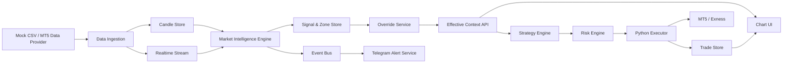

# 01 - Kiến trúc hệ thống

## Kiến trúc tổng thể

## Component chính

### 1. Data Ingestion

Nhiệm vụ:

- MVP: đọc file historical/mock XAUUSD H1/M15 do user bổ sung.
- Sau MVP: kết nối MT5 bằng Python `MetaTrader5` để lấy OHLCV historical và realtime từ Exness.
- Chuẩn hóa symbol, timeframe, timezone.
- Ghi dữ liệu candle vào database.
- Đẩy tick/candle update vào stream nội bộ.

Yêu cầu:

- Idempotent khi ingest lại historical data.
- Có kiểm tra missing candle.
- Có reconnect và retry khi chuyển sang MT5 realtime.
- Tách rõ raw data và normalized candle.
- Không yêu cầu order book, liquidation, funding trong MVP.
- Volume là optional vì MT5/Exness có thể chỉ cung cấp tick volume.

### 2. Candle Store

Lưu dữ liệu OHLCV theo symbol/timeframe.

Đề xuất ban đầu:

- SQLite/DuckDB có thể dùng ở prototype local.
- PostgreSQL + TimescaleDB nếu muốn production sớm.

Các query quan trọng:

- Lấy N candles gần nhất theo symbol/timeframe.
- Lấy range lịch sử phục vụ backtest.
- Kiểm tra data gap.
- Aggregate timeframe thấp lên timeframe cao nếu data provider không có sẵn.
- Với MVP, H1 và M15 có thể được load trực tiếp từ file riêng.

Decision:

- Có, dữ liệu nến phải được lưu vào database sau khi ingest từ file.
- File historical là nguồn import ban đầu, nhưng chart/replay/detector nên đọc từ Candle Store để logic giống nhau giữa backtest và live.
- Không nên chỉ đọc trực tiếp CSV ở mọi nơi, vì sẽ khó audit, khó kiểm tra missing candle và khó replay đồng nhất.

### 3. Market Intelligence Engine

Python service phân tích market theo nhiều module:

- Swing structure detector.
- BOS/CHOCH detector.
- Bias detector.
- Regime detector.
- Support/resistance detector.
- Order block detector.
- FVG detector.
- Liquidity sweep detector.
- Consolidation/range detector.
- Zone scoring engine.

Output không nên là text tự do. Mọi kết quả cần được emit dưới dạng structured event/entity để UI, alert và strategy dùng chung.

### 4. Signal & Zone Store

Lưu toàn bộ entity mà bot phát hiện:

- Bias.
- Regime.
- Price zone.
- Structure point.
- Setup candidate.
- Alert event.
- Trade idea.

Store này không chỉ lưu current state, mà nên lưu version/history để phục vụ replay và audit.

Decision:

- Có, dữ liệu của tất cả vùng giá phải được lưu vào database.
- Lưu cả vùng active, mitigated, invalidated, disabled, expired.
- Không xóa vùng cũ khỏi database; chỉ đổi `status` và set `end_time`.
- UI có thể bật/tắt hiển thị vùng cũ, nhưng dữ liệu vẫn phải còn để replay, backtest và review trade.
- Vùng gần nhất thường có weight cao hơn, nhưng không tự động là vùng duy nhất có giá trị. Weight nên kết hợp freshness, timeframe, reaction, confluence và invalidation state.
- Chiều dài ngang của zone trên chart biểu diễn khoảng thời gian zone còn valid: bắt đầu tại thời điểm tạo thành và kết thúc khi bị invalidated bởi phá cấu trúc, full mitigation, expiry hoặc human disable.

### 5. Override Service

Đây là phần đặc biệt của hệ thống.

Nhiệm vụ:

- Cho human overwrite bias/regime/zone/weight/status.
- Quản lý expiry của override.
- Tính `effective_value` từ bot value + human override.
- Lưu audit trail.
- Trả context cuối cùng cho UI, alert, strategy engine.

Rule quan trọng:

- Human override đang active luôn ưu tiên hơn bot value.
- Override mặc định hết hạn sau 4H nếu user không chọn.
- Human được phép set override không expiry.
- Override hết hạn không tự âm thầm chuyển về bot value để trade ngay; hệ thống phải alert và yêu cầu bot kiểm tra lại H1 Market Structure/Bias hiện tại trước khi effective context quay lại bot.
- Override có thể là chỉnh geometry vùng giá, đổi label, đổi confidence/weight, hoặc disable một vùng.
- Nếu bot invalidate vùng human đã chỉnh, vùng chỉ bị tắt sau khi human override hết hạn; trong thời gian override còn active, human vẫn là tác nhân chính.
- Mọi thay đổi của human phải có `reason` optional nhưng được khuyến khích.

### 6. Chart UI

Nhiệm vụ:

- Hiển thị chart realtime.
- Vẽ overlay: zone, OB, FVG, support/resistance, liquidity, swings, BOS/CHOCH.
- Cho phép kéo thả chỉnh vùng.
- Cho phép set weight/confidence/status/expiry.
- Hiển thị bot value và human effective value cạnh nhau khi cần.

Gợi ý frontend:

- Web app local: React/Next.js hoặc Vite React.
- Chart library: TradingView Lightweight Charts cho MVP.
- Realtime: WebSocket hoặc Server-Sent Events.
- Dark mode mặc định.
- Một chart XAUUSD trong MVP; multi-symbol/multi-chart để sau.
- Replay mode là requirement bắt buộc để backtest.

### 7. Telegram Alert Service

Nhận event từ engine hoặc strategy, áp dụng rule chống spam rồi gửi Telegram.

Alert nên có:

- Symbol/timeframe.
- Loại event.
- Giá hiện tại.
- Vùng liên quan.
- Bias/regime effective.
- Confidence/weight.
- Link mở chart UI tới đúng symbol/timeframe/entity.
- Gửi private message, không dùng group trong MVP.
- Không cần nhiều mức alert ở UI/Telegram MVP; tất cả entity mới, state change, bias/regime change và trade/execution event đều phải gửi.
- Nếu khả thi, gửi kèm chart snapshot có entry/SL/TP khi có setup.

### 8. Strategy Engine

Không đặt lệnh trực tiếp. Strategy Engine tạo trade idea hoặc execution request.

Input:

- Effective context từ Override Service.
- Market structure.
- Zones.
- Current price action.
- Risk mode.

Output:

- Setup candidate.
- Entry condition.
- Invalidation.
- Suggested SL/TP.
- Confidence.
- Required human action.

### 9. Risk Engine

Nằm giữa strategy và executor.

Nhiệm vụ:

- Kiểm tra max risk per trade: 1%.
- Kiểm tra max daily loss: 5%.
- Kiểm tra spread/slippage.
- Kiểm tra news/high-volatility block nếu có.
- Kiểm tra max 10 lệnh/ngày.
- Chặn execution nếu thiếu human confirmation theo mode.

### 10. Python Executor

Nhiệm vụ:

- Sau MVP: kết nối MT5 Exness bằng Python `MetaTrader5`.
- Hỗ trợ order market và limit.
- Đồng bộ trạng thái position/order.
- Ghi execution log.

Executor không được tự suy luận strategy. Nó chỉ thực thi request đã qua Risk Engine.

### 11. Trade Store

Lưu toàn bộ trade idea, backtest trade, execution request, order, fill và position.

Decision:

- Tất cả lệnh trade cũ phải được lưu vào database.
- Chart UI phải vẽ được toàn bộ lệnh cũ trên chart, gồm entry, SL, TP, close, PnL và trạng thái.
- Backtest/replay trade và live trade dùng chung mô hình dữ liệu càng nhiều càng tốt.
- Không chỉ lưu trade summary; cần lưu event timeline để biết lệnh được tạo từ setup nào, context nào, vùng nào và human có override gì tại thời điểm đó.

## Giao tiếp nội bộ

MVP có thể dùng:

- REST API cho query state.
- WebSocket/SSE cho realtime UI.
- Internal event queue đơn giản bằng Redis Streams hoặc database polling.

Production có thể nâng cấp:

- Kafka/Redpanda/NATS cho event stream.
- Separate services rõ ràng.
- Replay engine cho backtest và debug.

## Deployment gợi ý

### Local prototype

- Python analyzer chạy local.
- SQLite/Postgres local.
- Web UI local.
- Telegram bot thật.
- Mock data/replay từ file XAUUSD H1/M15.
- Không connect account thật trên Macbook MVP.

### Production nhỏ

- Docker Compose.
- Postgres/TimescaleDB.
- Redis.
- API service.
- Analyzer worker.
- UI.
- Telegram worker.
- Executor worker MT5 chạy riêng, có secret isolation.

## Ranh giới an toàn

- Analyzer lỗi không được làm executor đặt lệnh.
- UI disconnect không được làm mất override đã lưu.
- Data provider lỗi phải đưa system vào degraded mode.
- Bot confidence thấp không được tự escalate thành execution.
- Override hết hạn phải được hiển thị rõ, tránh human tưởng vẫn còn hiệu lực.
