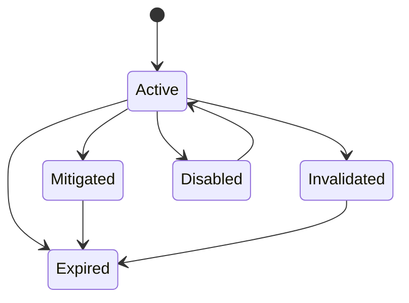

# 02 - Mô hình dữ liệu và Human Override

## Nguyên tắc dữ liệu

Mọi nhận định của bot và human nên được lưu thành entity có version. Không ghi đè mất lịch sử.

Một entity cần trả lời được:

- Ai tạo ra?
- Tạo khi nào?
- Dựa trên timeframe nào?
- Có hiệu lực đến khi nào?
- Confidence/weight bao nhiêu?
- Đã bị human chỉnh chưa?
- Effective value hiện tại là gì?
- Vì sao alert hoặc setup được tạo?

## Entity nền tảng

### Market Candle

```yaml
candle:
  id: string
  symbol: string
  timeframe: H1 | M15 | M5 | D1
  open_time: datetime
  close_time: datetime
  open: decimal
  high: decimal
  low: decimal
  close: decimal
  volume: decimal
  source: string
```

### Market Context

Lưu bias và regime theo symbol/timeframe.

```yaml
market_context:
  id: string
  symbol: string
  timeframe: string
  context_type: bias | regime
  bot_value: bullish | bearish | neutral | trending | ranging | expansion | contraction | high_volatility | low_volatility
  primary_value: string
  secondary_value: string | null
  bot_confidence: float
  effective_value: string
  effective_confidence: float
  source: bot | human | mixed
  valid_from: datetime
  valid_until: datetime | null
  status: active | expired | superseded
  created_at: datetime
  updated_at: datetime
```

`primary_value` là bias/regime chính dùng để chọn hướng ưu tiên. `secondary_value` chỉ được set bởi human khi muốn cho bot xét thêm một hướng/logic phụ, ví dụ H1 primary bias bullish nhưng human cho phép secondary bearish để đánh mean reversion hoặc breakout thất bại. Bot không tự tạo dual-bias trong MVP.

### Price Zone

Dùng cho support/resistance, OB, FVG, liquidity pool, consolidation range.

```yaml
price_zone:
  id: string
  symbol: string
  timeframe: string
  zone_type: support | resistance | order_block | fvg | liquidity | consolidation | supply | demand
  direction: bullish | bearish | neutral
  price_low: decimal
  price_high: decimal
  start_time: datetime
  end_time: datetime | null
  valid_from: datetime
  valid_until: datetime | null
  invalidated_at: datetime | null
  invalidated_by_structure_point_id: string | null
  detected_at: datetime
  bot_confidence: float
  bot_weight: float
  effective_confidence: float
  effective_weight: float
  status: active | mitigated | invalidated | disabled | expired
  source: bot | human | mixed
  metadata: json
```

`start_time` là thời điểm vùng được hình thành trên chart. `end_time` là điểm kết thúc visual của vùng trên chart. Price zone active không được kéo vô hạn: mọi zone bot/human đều phải có `valid_until`, và khi hết hạn hệ thống set `end_time = valid_until`. Khi vùng bị phá cấu trúc, full mitigation, expiry hoặc bị human disable, hệ thống set `end_time` để zone dừng tại đúng thời điểm đó.

`valid_from/valid_until` biểu diễn hiệu lực logic của vùng. Trong đa số trường hợp `valid_from = start_time` và `valid_until = end_time`, nhưng tách riêng hai field giúp xử lý tình huống human override, replay hoặc vùng vẫn được hiển thị lịch sử dù không còn được strategy dùng.

Decision:

- Mọi zone bot/human tạo ra đều lưu database.
- Không xóa zone cũ; zone cũ chuyển status và có `end_time`.
- Chiều dài ngang của zone trên UI là tín hiệu quan trọng: nó cho thấy vùng còn valid tới đâu trong thời gian.
- Vùng bắt đầu khi pattern/structure tạo thành.
- Vùng kết thúc khi structure phá vỡ/invalidation xảy ra, hoặc khi full mitigation/expiry/human disable theo rule.
- Price zone không có no-expiry. FVG/OB dùng max active days theo detector; SR/manual/zone khác mặc định 24h nếu không có expiry riêng.
- Vùng gần nhất thường được cộng freshness score, nhưng vẫn cần score bằng confluence, timeframe và phản ứng giá.

### Structure Point

```yaml
structure_point:
  id: string
  symbol: string
  timeframe: string
  point_type: HH | HL | LH | LL | swing_high | swing_low | BOS | CHOCH
  price: decimal
  event_time: datetime
  confidence: float
  related_zone_ids: string[]
  metadata: json
```

### Trade Idea / Order / Fill

Trade data cũng là entity phải lưu, không chỉ là log text.

```yaml
trade_idea:
  id: string
  symbol: string
  direction: long | short
  playbook: trend_pullback | sweep_reversal | breakout_retest | range_reversal
  status: candidate | waiting_confirmation | backtest_open | backtest_closed | approved | rejected | expired
  entry_zone_id: string | null
  related_zone_ids: string[]
  context_snapshot: json
  suggested_entry: decimal | null
  suggested_stop_loss: decimal
  suggested_take_profit: decimal[]
  risk_reward: float
  created_at: datetime
  expires_at: datetime | null
```

```yaml
trade_order:
  id: string
  trade_idea_id: string
  symbol: string
  side: buy | sell
  order_type: market | limit
  status: pending | filled | partially_filled | cancelled | rejected | expired
  entry_price: decimal | null
  stop_loss: decimal
  take_profit: decimal[]
  quantity: decimal
  opened_at: datetime | null
  closed_at: datetime | null
  close_price: decimal | null
  pnl: decimal | null
  pnl_r: decimal | null
  source: backtest | live
  metadata: json
```

```yaml
trade_fill:
  id: string
  trade_order_id: string
  fill_time: datetime
  fill_price: decimal
  quantity: decimal
  fee: decimal | null
  source: backtest | mt5
```

Chart UI sẽ đọc các entity này để vẽ toàn bộ lệnh cũ: entry marker, SL line, TP line, close marker, PnL và link về setup/zone gốc.

### Override

```yaml
override:
  id: string
  target_entity_type: market_context | price_zone | setup_candidate
  target_entity_id: string
  override_type: value | geometry | confidence | weight | status | expiry | note
  patch: json
  reason: string | null
  created_by: human
  created_at: datetime
  expires_at: datetime | null
  status: active | expired | revoked | superseded
```

Mặc định `expires_at` là sau 4H nếu human không chọn. Price-zone override không được no-expiry; context override no-expiry là quyết định riêng nếu cần.

## Effective Value Rule

Khi UI, alert hoặc strategy cần context, hệ thống không dùng trực tiếp bot value. Nó gọi Effective Context API.

Priority:

1. Lấy bot entity mới nhất còn active.
2. Lấy human override active cho entity đó.
3. Apply override theo thứ tự thời gian.
4. Nếu override hết hạn, tạo alert trước và yêu cầu recompute H1 Market Structure/Bias trước khi bỏ override khỏi effective result.
5. Nếu human disable entity, entity vẫn lưu nhưng không được dùng cho alert/strategy trừ khi user bật lại.
6. Nếu bot invalidate entity đang có human override active, ghi trạng thái `bot_invalidated_pending_human_expiry`; chỉ tắt effective entity sau khi override hết hạn hoặc human revoke.

Ví dụ bias:

```yaml
bot:
  bias: bullish
  confidence: 0.72
human_override:
  bias: bearish
  expires_at: "2026-05-30T14:00:00+07:00"
effective:
  bias: bearish
  source: human
```

Sau expiry:

```yaml
effective:
  bias: bullish
  source: bot
  recomputed_after_expiry: true
```

Trước khi đổi về bot, hệ thống phải gửi alert private Telegram/UI rằng human override sắp hết hạn hoặc đã hết hạn và bot đang recompute bias H1.

## Chỉnh geometry zone

Khi bot detect resistance quá rộng:

Bot zone:

```yaml
price_low: 2500
price_high: 2525
```

Human kéo thu hẹp:

```yaml
patch:
  price_low: 2510
  price_high: 2520
  effective_weight: 0.85
  note: "Thu hẹp theo wick rejection gần nhất"
```

Không sửa mất bot geometry gốc. UI có thể hiển thị:

- Bot zone bằng nét mờ.
- Effective zone bằng nét rõ.
- Badge `human adjusted`.

## Dual Bias do Human set

Hệ thống cần hỗ trợ một primary bias và một optional secondary bias.

Ví dụ:

```yaml
effective_bias:
  primary: bullish
  secondary: bearish
  secondary_reason: "Human allows mean-reversion short if breakout fails at H1 resistance"
  source: human
  expires_at: null
```

Rule:

- Bot tự xác định primary bias theo H1 Market Structure.
- Secondary bias chỉ có khi human set.
- Strategy Engine phải đọc playbook permission trước khi dùng secondary bias.
- Alert phải ghi rõ setup đang dùng primary hay secondary bias.

## Weight và Confidence

Đề xuất tách `confidence` và `weight`.

`confidence` trả lời: "Detector/human tin vùng này đúng đến đâu?"

`weight` trả lời: "Vùng này quan trọng đến đâu trong quyết định trade?"

Ví dụ:

- FVG mới tạo có confidence cao nhưng weight thấp nếu ngược HTF bias.
- Resistance cũ nhiều lần phản ứng có weight cao nhưng confidence giảm nếu đã bị test quá nhiều.

Thang điểm:

- `0.0 - 0.3`: yếu, chỉ tham khảo.
- `0.3 - 0.6`: trung bình, cần confirm thêm.
- `0.6 - 0.8`: đáng chú ý.
- `0.8 - 1.0`: vùng trọng yếu.

## Zone lifecycle



Ý nghĩa:

- `active`: còn dùng được.
- `mitigated`: đã được giá chạm/lấp một phần, vẫn có thể có giá trị tùy rule.
- `invalidated`: giá phá qua theo điều kiện invalidation.
- `disabled`: human tắt.
- `expired`: quá cũ hoặc override hết hạn.

## Zone Visual Validity

Zone không nên chỉ là một rectangle vô hạn kéo mãi sang phải. Mỗi zone có một đoạn đời trên chart.

Rule visual:

- Khi mới detect, zone bắt đầu tại `start_time`.
- Nếu zone còn active, UI kéo zone tới candle hiện tại.
- Khi bị invalidated, set `end_time = invalidated_at`.
- Khi FVG filled 80-100% hoặc OB full mitigation theo rule, có thể set `end_time` hoặc chuyển status tùy detector.
- Khi human disable zone, set `end_time` tại thời điểm disable nếu disable làm vùng không còn valid.
- Khi human override geometry, bot raw zone vẫn giữ lịch sử; effective zone có thể có visual range riêng.

Ý nghĩa trading:

- Zone gần hiện tại thường đáng chú ý hơn vì freshness cao.
- Zone cũ vẫn có thể quan trọng nếu là HTF level hoặc có phản ứng nhiều lần.
- Strategy không dùng zone đã hết visual validity, trừ khi human explicitly re-enable hoặc dùng để phân tích lịch sử.

## Audit trail

Mọi thay đổi quan trọng cần ghi:

- Before/after.
- User/action.
- Timestamp.
- Entity affected.
- Reason nếu có.

Audit trail giúp:

- Review vì sao trade được vào.
- Huấn luyện lại rule detector.
- Tìm lỗi do bot hay do human override.
- Tạo thống kê: human override cải thiện hay làm giảm performance.

## API gợi ý

```http
GET /api/context/effective?symbol=XAUUSD&timeframe=H1
GET /api/chart?symbol=XAUUSD&timeframe=M15&limit=300
GET /api/zones?symbol=XAUUSD&timeframe=H1&effective=true
POST /api/overrides
PATCH /api/overrides/{id}/revoke
GET /api/entities/{type}/{id}/history
```

Trong MVP local, endpoint chart có thể được mô phỏng bằng CLI:

```bash
python3 -m semi_bot_trading.cli export-chart-json --timeframe M15 --limit 300 --output var/chart_xauusd_m15.json
```

Payload chart phải gom candles theo chart timeframe, nhưng price zones và structure trade context luôn là H1. Điều này giúp UI xem được M15 trigger candles mà không biến M15 thành price-zone context.

## Decisions hiện tại

- Hệ thống chỉ dành cho một user, không cần multi-profile/user permission trong MVP.
- Override default expiry là 4H.
- Human có thể set override không expiry.
- Không cần human lock zone.
- Bot có thể detect invalidation, nhưng effective zone human chỉnh chỉ bị tắt khi override hết hạn hoặc human revoke.
- Cần snapshot toàn bộ context tại thời điểm tạo trade idea/backtest trade.
