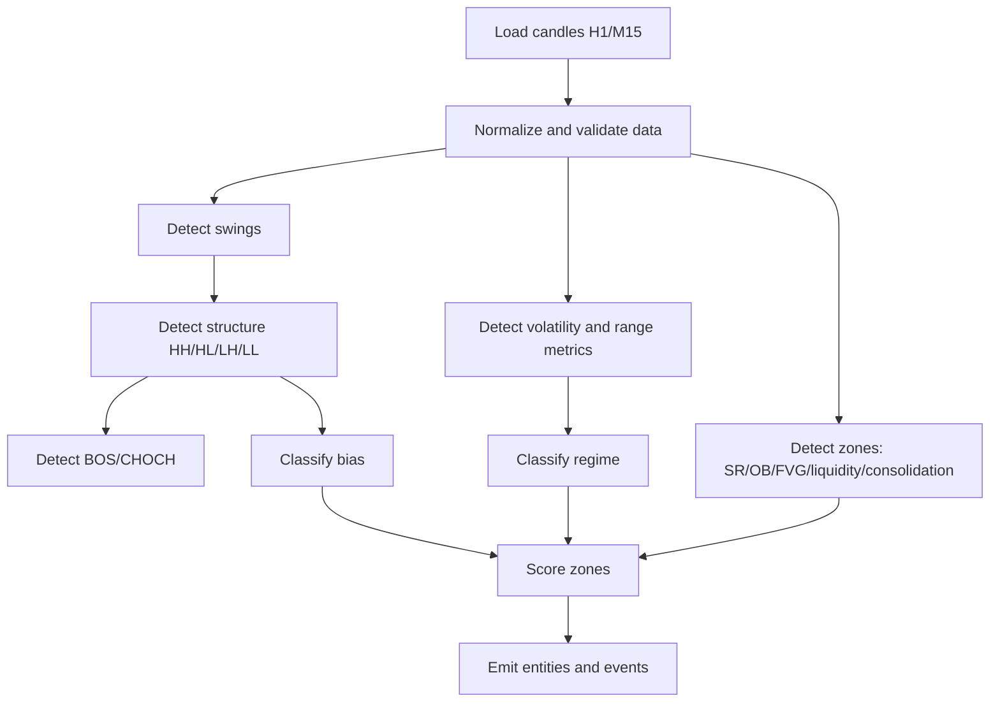

# 03 - Market Intelligence Engine

## Mục tiêu

Market Intelligence Engine là trái tim phân tích của hệ thống. Nó không đặt lệnh. Nó chỉ tạo structured market knowledge để UI, alert, strategy và human dùng.

## Input

- Historical candles.
- MVP: mock/historical XAUUSD H1/M15 candles từ file.
- Sau MVP: realtime candle updates từ MT5/Exness qua Python `MetaTrader5`.
- Multi-timeframe context H1 + M15.
- Human overrides active.
- Optional: session/time-of-day, news calendar, tick volume.
- Không dùng order book, liquidation, funding trong MVP.

## Output

- Bias.
- Regime.
- Swing structure.
- BOS/CHOCH.
- Support/resistance zones.
- Order blocks.
- Fair Value Gaps.
- Liquidity sweeps.
- Consolidation/range zones.
- Setup candidates.
- Alert events.

## Pipeline phân tích



## Swing Structure

MVP detector:

- Dùng pivot/fractal swing với window có thể config.
- Một swing high là nến có high cao hơn N nến trước và N nến sau.
- Một swing low là nến có low thấp hơn N nến trước và N nến sau.
- H1 dùng window lớn hơn M15.

Output:

- `swing_high`, `swing_low`.
- `HH`, `HL`, `LH`, `LL` khi so với swing trước đó.
- `BOS` khi giá phá structure theo hướng trend.
- `CHOCH` khi phá structure ngược bias gần nhất.

Điểm cần cẩn thận:

- Swing realtime có thể repaint khi nến chưa đóng.
- Cần flag `confirmed=false` cho swing chưa xác nhận.
- Strategy chỉ nên dùng confirmed structure, còn UI có thể hiển thị provisional structure bằng style mờ.

## Bias Detection

Bias chính:

- `bullish`
- `bearish`
- `neutral`

Rule H1 MVP:

- Bias là hướng thiên vị/kỳ vọng chính về hướng giá trong một khoảng thời gian.
- Ưu tiên chính là Market Structure: HH/HL cho bullish, LH/LL cho bearish.
- BOS dùng để xác nhận và củng cố bias.
- CHOCH dùng để cảnh báo bias có thể đổi chiều; chỉ đổi bias khi H1 có CHOCH rõ ràng.
- Thứ tự ưu tiên: HH/HL hoặc LH/LL -> BOS -> CHOCH.
- Neutral khi H1 sideway/range rõ, không tạo được HH/HL hoặc LH/LL mới, liên tục có Equal Highs/Equal Lows và không có BOS mạnh.

Rule M15:

- H1 là bias chính trong MVP, không dùng H4 để lọc bias.
- Khi H1 bullish nhưng M15 bearish, vẫn giữ `primary_bias=bullish`; M15 bearish chỉ là pullback tạm thời.
- Khi H1 bearish nhưng M15 bullish, vẫn giữ `primary_bias=bearish`; M15 bullish chỉ là pullback tạm thời.
- Chỉ chuyển primary bias khi H1 xuất hiện CHOCH rõ ràng.
- Human có thể set `secondary_bias` để bot xét thêm kịch bản breakout hoặc mean reversion; bot không tự set secondary bias trong MVP.

Output nên kèm lý do:

```yaml
bias:
  primary: bullish
  secondary: null
  confidence: 0.74
  reasons:
    - "H1 created HH and HL"
    - "Latest BOS upward"
    - "Price above last H1 demand zone"
```

## Regime Detection

Regime là trạng thái vận động hiện tại của thị trường, mô tả cách giá đang di chuyển về độ mạnh, tốc độ và tính chất. Regime giúp chọn playbook phù hợp: trend follow, mean reversion, breakout, hoặc đứng ngoài.

Taxonomy MVP:

- Primary regime: `trending` hoặc `ranging`.
- Momentum/compression overlay: `expansion` hoặc `contraction`.
- Volatility overlay: `high_volatility` hoặc `low_volatility`.
- Special overlay: `news` hoặc `risk_off`.

Một thời điểm chỉ có một primary regime, nhưng có thể có nhiều overlay. Ví dụ: `trending + expansion + high_volatility`.

Metric gợi ý:

- ATR percentile.
- Candle body/range ratio.
- ADX hoặc slope MA nếu muốn thêm indicator.
- Range width so với ATR.
- Số lần giá chạm biên range.
- Compression: ATR giảm dần, candle nhỏ, Bollinger width giảm nếu dùng.
- Expansion: range candle tăng nhanh, displacement candle, breakout khỏi consolidation.

Rule MVP:

```yaml
trending:
  conditions:
    - repeated BOS same direction
    - structure HH/HL or LH/LL clear
    - ATR not too low
ranging:
  conditions:
    - price oscillates between support/resistance
    - BOS weak or failed
    - range width stable
expansion:
  conditions:
    - ATR percentile high and increasing
    - displacement candle breaks range/structure
contraction:
  conditions:
    - ATR decreasing
    - candle ranges shrinking
    - price compressed near range/midpoint
high_volatility:
  conditions:
    - ATR percentile very high
    - wick/body noise high
low_volatility:
  conditions:
    - ATR percentile very low
    - slow movement, small candles
news:
  conditions:
    - manually set by human or calendar integration later
    - extreme volatility around CPI, NFP, interest rate events
risk_off:
  conditions:
    - manually set by human in MVP
    - macro/geopolitical stress context
```

## Support / Resistance

Detector ban đầu:

- Gom các swing highs gần nhau thành resistance.
- Gom các swing lows gần nhau thành support.
- Có thể dùng ZigZag hoặc pivot/fractal swing để xác định Swing High/Swing Low.
- Dùng tolerance theo ATR hoặc pip distance của XAUUSD.
- Tăng weight nếu vùng có nhiều lần phản ứng.
- Giảm weight nếu vùng bị xuyên qua nhiều lần hoặc quá cũ.

Lưu ý: Support/Resistance không dùng chung logic với consolidation/sideway. Consolidation là range state riêng, được xác định bằng biên high/low ổn định, số lần touch và volatility thấp/thu hẹp.

Metadata nên lưu:

- Touch count.
- Last reaction time.
- Average rejection size.
- Broken count.
- Related swings.

## Order Block

Definition MVP:

Order Block là vùng giá quan trọng nơi Smart Money/Institutional có thể đã đặt lệnh lớn, thường là cây nến cuối cùng trước một Displacement mạnh.

- Bullish OB: nến giảm cuối cùng trước displacement tăng phá structure.
- Bearish OB: nến tăng cuối cùng trước displacement giảm phá structure.
- OB chỉ valid nếu displacement đủ mạnh và tạo BOS/CHOCH.
- OB có thể bị mitigated khi giá quay lại chạm vùng.
- Ưu tiên lấy body của nến làm vùng chính.
- Wick chỉ là vùng mở rộng/tham khảo, đặc biệt khi wick dài.
- Invalidated khi có nến close mạnh xuyên qua OB kèm displacement ngược chiều.
- Wick chạm hoặc xuyên nhẹ không invalidate.
- Mitigated dưới 30-40%: OB vẫn giữ giá trị cao.
- Mitigated từ 50% trở lên: giảm weight rõ.
- Mitigated 80-100%: giảm weight mạnh, coi như yếu hoặc gần mất hiệu lực.

Scoring:

- Có BOS/CHOCH sau OB: tăng weight.
- OB nằm cùng HTF bias: tăng weight.
- OB chồng với support/resistance/FVG: tăng weight.
- OB quá rộng: giảm weight hoặc yêu cầu human chỉnh.
- OB đã mitigated nhiều lần: giảm weight.

## Fair Value Gap

Definition 3-candle classic:

- Bullish FVG khi low của candle 3 cao hơn high của candle 1.
- Bearish FVG khi high của candle 3 thấp hơn low của candle 1.
- Nến giữa là impulse/displacement candle mạnh.
- Nến 1 và nến 3 không overlap, tạo imbalance rõ.
- FVG cùng hướng HTF bias được ưu tiên alert.
- FVG ngược HTF bias không alert ưu tiên, chỉ alert weight thấp nếu có confluence cực mạnh như Liquidity Sweep + CHOCH.
- Consequent Encroachment 50% được dùng như confluence phụ/cảnh báo FVG yếu dần.

Metadata:

- Gap high/low.
- Filled percentage.
- Created by displacement hay không.
- Related BOS/CHOCH.
- Time since creation.

Lifecycle:

- `active`: fill dưới 50%, vẫn giữ giá trị cao.
- `partial_fill`: fill 50-79%, weight giảm rõ.
- `filled`: fill 80-100%, coi như mitigated hoàn toàn.
- `invalidated`: giá phá qua theo rule.

## Liquidity Sweep

Detector ban đầu:

- Giá phá lên trên swing high/range high rồi đóng lại dưới vùng.
- Giá phá xuống dưới swing low/range low rồi đóng lại trên vùng.
- Có wick vượt vùng rõ ràng.
- Tăng weight nếu sweep xảy ra tại liquidity pool nhiều touch.
- Ưu tiên sweep có close reclaim thay vì chỉ wick sweep.
- Sweep M15 tại vùng H1 có weight cao hơn sweep độc lập trên M15.
- Sweep là context/trigger candidate; entry vẫn cần M15 confirmation như displacement, engulfing, pinbar hoặc BOS.

Output:

- Sweep direction.
- Swept level.
- Reclaim candle.
- Related zone.
- Potential reversal context.

## Consolidation / Range

Detector ban đầu:

- N candles gần nhất có high/low nằm trong biên ổn định.
- ATR thấp hoặc giảm.
- Có ít nhất 2 touch gần range high và 2 touch gần range low.
- Breakout khỏi range có thể chuyển sang expansion regime.
- Equal Highs/Equal Lows lặp lại là dấu hiệu hỗ trợ neutral bias.

Range entity:

```yaml
zone_type: consolidation
price_low: range_low
price_high: range_high
metadata:
  touches_high: 3
  touches_low: 2
  atr_percentile: 0.24
```

## Zone Scoring Engine

Score tổng hợp gợi ý:

```text
score = structure_score
      + confluence_score
      + freshness_score
      + timeframe_score
      + reaction_score
      - invalidation_penalty
      - noise_penalty
```

Thành phần:

- Structure score: có liên quan BOS/CHOCH không.
- Confluence score: overlap SR + OB + FVG + liquidity.
- Freshness score: vùng mới thường tốt hơn vùng quá cũ.
- Timeframe score: H1 zone thường nặng hơn M15 zone.
- Reaction score: giá phản ứng rõ ở vùng.
- Invalidation penalty: bị phá hoặc test quá nhiều.
- Noise penalty: high volatility fakeout.

## Zone validity length

Mỗi vùng giá cần có chiều dài hiệu lực trên trục thời gian.

Rule:

- `start_time`: thời điểm vùng được hình thành, ví dụ candle tạo OB/FVG hoặc swing tạo support/resistance.
- `end_time = null`: vùng còn active, UI kéo vùng tới candle hiện tại.
- `end_time = invalidated_at`: vùng dừng lại khi cấu trúc bị phá vỡ hoặc detector xác nhận invalidation.
- OB invalidated khi close mạnh xuyên vùng kèm displacement ngược chiều.
- FVG có thể kết thúc khi filled 80-100%, hoặc chuyển partial/fill status theo fill percentage.
- Support/resistance kết thúc khi structure break rõ ràng hoặc giá đóng phá vùng theo rule.
- Consolidation kết thúc khi breakout khỏi range kèm displacement.

Freshness:

- Vùng gần nhất thường được cộng freshness score.
- Freshness không thay thế confluence: HTF zone cũ nhưng nhiều phản ứng vẫn có thể quan trọng.
- Zone đã có `end_time` không được dùng cho setup mới, nhưng vẫn hiển thị khi replay/review nếu user bật historical zones.

## Realtime behavior

Engine nên chạy theo event:

- On candle close: cập nhật confirmed structure.
- On intrabar price update: cập nhật proximity alert, provisional sweep, zone touch.
- On human override: recompute effective context và strategy candidates.
- On override expiring soon/expired: gửi alert, recompute H1 bias/structure rồi mới trả bot effective context.
- MVP replay mode chạy theo từng candle close từ file historical.

## Test strategy

- Unit test từng detector bằng candle fixture nhỏ.
- Snapshot test output entity.
- Replay historical data để kiểm tra repaint.
- Backtest detector không cần executor trước.
- So sánh bot zone với human adjusted zone để đo chất lượng.
