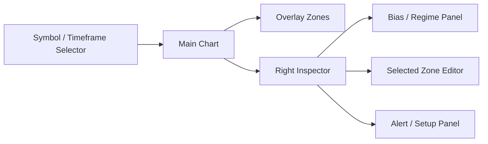

# 04 - Chart UI và Human Workflow

## Mục tiêu UI

Chart UI là nơi human và bot gặp nhau. UI không chỉ hiển thị chart, mà phải giúp trader chỉnh context nhanh, rõ và có audit.

MVP UI là web app local, dark mode mặc định, tập trung một symbol XAUUSD với hai timeframe H1 + M15. Replay mode là requirement bắt buộc để backtest trước khi nối MT5/live execution.

## Layout MVP



## Màn hình chính

Thành phần:

- Candlestick chart realtime hoặc replay.
- Timeframe switch: H1, M15; M5 để sau nếu M15 entry chưa đủ tốt.
- Symbol selector có thể tồn tại trong UI, nhưng MVP chỉ bật XAUUSD.
- Overlay toggle: SR, OB, FVG, liquidity, swings, BOS/CHOCH, consolidation.
- Overlay toggle cho trades: historical trades, backtest trades, live trades.
- Right inspector cho entity đang chọn.
- Status bar: data connection, analyzer state, last candle close, alert state.

## Overlay style gợi ý

- Support: xanh lá nhẹ.
- Resistance: đỏ/cam nhẹ.
- Bullish OB: xanh lá đậm hơn support.
- Bearish OB: đỏ đậm hơn resistance.
- FVG: xanh/tím nhạt, opacity thấp.
- Liquidity: line dashed.
- Consolidation: rectangle viền trung tính.
- Bot-only entity: opacity thấp.
- Human-adjusted entity: border rõ + badge.
- Disabled entity: xám mờ.
- Historical invalidated entity: chỉ hiển thị khi bật historical zones, kết thúc tại `end_time`.
- Active zone: kéo ngang từ `start_time` tới candle hiện tại.
- Closed/invalidated zone: kéo ngang từ `start_time` tới `end_time`, không kéo vô hạn sang phải.

## Trade overlay

UI phải vẽ được tất cả lệnh cũ trên chart.

Các thành phần:

- Entry marker tại thời điểm/giá vào lệnh.
- SL line.
- TP line hoặc nhiều TP lines nếu backtest có scale-out.
- Close marker tại thời điểm/giá đóng lệnh.
- PnL/PnL R label.
- Link từ trade về trade idea, playbook, zone và context snapshot.

Filter:

- Show all trades.
- Backtest only.
- Live only.
- Winning/losing trades.
- Filter theo playbook.

Mục tiêu là khi review một setup, user thấy được trade đã vào ở đâu so với OB/FVG/SR/liquidity và bias/regime lúc đó.

## Chart payload contract MVP

Backend xuất một payload chart-ready để UI có thể render ngay, chưa cần gọi nhiều API rời rạc trong giai đoạn đầu.

```json
{
  "version": 1,
  "symbol": "XAUUSD",
  "timeframe": "M15",
  "range": {
    "start": "2026-03-16T06:45:00+00:00",
    "end": "2026-03-19T12:30:00+00:00",
    "limit": 300
  },
  "layers": {
    "candles": [],
    "structure": [],
    "zones": [],
    "contexts": {
      "H1": {
        "bias": {},
        "regime": {}
      }
    },
    "trades": []
  }
}
```

Quy ước:

- `candles`: dữ liệu OHLCV để vẽ chart chính.
- `structure`: HH/HL/LH/LL, BOS, CHOCH trong range đang xem.
- `zones`: vùng giá có `visual_start` và `visual_end`; active zone có `visual_end = null`, UI kéo tới candle hiện tại.
- `contexts`: map theo timeframe để chart M15 vẫn đọc được H1 bias/regime.
- `trades`: toàn bộ lệnh lịch sử/backtest/live giao với range chart, dùng để vẽ entry, SL, TP, close và PnL.

Trong code MVP hiện tại, contract này được phục vụ bởi FastAPI:

```bash
python3 -m semi_bot_trading.cli serve-api --port 8000
```

Frontend React/Vite chạy ở `http://127.0.0.1:5173`, dùng TradingView Lightweight Charts và đọc `/api/chart?symbol=XAUUSD&timeframe=M15&limit=300` qua Vite proxy. UI canvas thuần cũ ở `serve-chart` chỉ còn là prototype tham khảo.

## Workflow chỉnh zone

1. Bot detect zone và vẽ lên chart.
2. Human click zone.
3. Inspector mở chi tiết:
   - Type.
   - Timeframe.
   - Bot price range.
   - Effective price range.
   - Confidence.
   - Weight.
   - Status.
   - Related structure.
4. Human kéo biên trên/dưới trên chart hoặc nhập số.
5. Human set weight/confidence nếu cần.
6. Human chọn expiry:
   - 4h default.
   - 30m.
   - 1h.
   - Until session end.
   - Until invalidated.
   - No expiry.
   - Custom.
7. Save override.
8. UI cập nhật effective zone realtime.

## Workflow overwrite bias/regime

Ví dụ bot xác định H1 bullish nhưng human muốn set bearish trong 4h:

1. Human mở Bias/Regime panel.
2. Chọn H1 bias.
3. Chọn `bearish`.
4. Set expiry `4h`.
5. Optional reason: "HTF supply + sweep failed breakout".
6. Save.
7. UI hiển thị:
   - Bot: bullish.
   - Effective: bearish by human, expires in 4h.
8. Strategy và alert dùng effective bearish cho tới khi hết hạn.
9. Trước/hay khi hết hạn, UI và Telegram alert rằng override sắp hết hạn/hết hạn; bot recompute lại H1 Market Structure/Bias trước khi trả context về bot.

## Workflow dual-bias do Human set

Bot chỉ tự xác định primary bias. Human có thể set secondary bias khi muốn cho phép strategy xét thêm kịch bản breakout hoặc mean reversion.

Ví dụ:

1. Bot xác định H1 primary bias bullish.
2. Human thấy XAUUSD đang ở H1 resistance và muốn cho phép short mean reversion nếu có sweep thất bại.
3. Human set secondary bias bearish, chọn playbook allowed là `sweep_reversal` hoặc `range_reversal`.
4. UI hiển thị:
   - Primary: bullish by bot.
   - Secondary: bearish by human.
   - Allowed playbooks: sweep reversal, range reversal.
5. Alert/setup phải ghi rõ setup đang dùng primary hay secondary bias.

## Entity Inspector

Thông tin cần có khi chọn một vùng:

- Entity ID ngắn.
- Source: bot/human/mixed.
- Timeframe.
- Zone type.
- Direction.
- Price low/high.
- Weight/confidence.
- Age.
- Touch count.
- Mitigation/fill percentage.
- Related BOS/CHOCH/swing.
- Active overrides.
- Visual validity: `start_time`, `end_time`, invalidation reason.
- History button.

Actions:

- Edit geometry.
- Change weight.
- Change status.
- Disable.
- Re-enable.
- Set expiry.
- Add note.
- Revert human override.
- Set secondary bias permission nếu entity/context phù hợp.

## Alert UX

Alert trong UI nên có inbox nhỏ:

- New zone detected.
- Price approaching zone.
- Price touched zone.
- Sweep detected.
- Setup candidate formed.
- Bias/regime changed.
- Human override expiring soon.

Mỗi alert nên click để focus chart vào vùng liên quan.

## Interaction requirements

- Kéo vùng không làm giật chart.
- Save override phản hồi dưới 300ms local.
- Nếu API fail, UI phải rollback hoặc hiển thị pending/error rõ.
- Không cho user chỉnh nhầm bot raw value; chỉnh vào override layer.
- Có undo gần nhất cho chỉnh geometry.

## Realtime requirements

- Candle mới cập nhật realtime.
- Bot entity mới xuất hiện không được làm mất selection hiện tại.
- Khi human đang kéo vùng, update từ bot không được ghi đè thao tác đang diễn ra.
- Nếu override hết hạn trong lúc mở chart, UI phải refresh effective state và báo rõ.

## Suggested frontend stack

MVP:

- React + Vite + TypeScript.
- TradingView Lightweight Charts.
- Zustand cho client state.
- TanStack Query cho server state/cache.
- Tailwind CSS cho dark UI.
- FastAPI làm API gateway giữa FE và bot/database.
- WebSocket/SSE cho realtime.
- REST API cho save/read entities.
- Dark mode mặc định.
- Replay controls: play, pause, step candle, speed, reset.

Không nên build chart engine từ đầu ở MVP.

## Accessibility và usability

- Dùng màu nhưng không phụ thuộc hoàn toàn vào màu; thêm label/line style.
- Hit target vùng đủ dễ click.
- Có list entity bên cạnh để chọn nếu vùng overlap.
- Có hotkey sau MVP, nhưng không cần trong bản đầu.

## Cần mock sớm

Trước khi nối data thật, nên có mock UI với candle fixture và entity fixture để kiểm tra:

- Vẽ nhiều loại zone.
- Drag resize zone.
- Override expiry.
- Toggle overlay.
- Click alert focus entity.
- Replay XAUUSD H1/M15 từ file historical.
