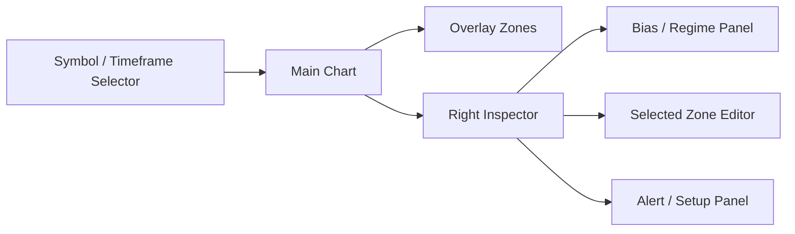

# 04 - Chart UI và Human Workflow

## Mục tiêu UI

Chart UI là nơi human và bot gặp nhau. UI không chỉ hiển thị chart, mà phải giúp trader chỉnh context nhanh, rõ và có audit.

MVP UI là web app local, dark mode mặc định, tập trung một symbol XAUUSD với H1 + M15; M5 được dùng làm execution timeframe cho Manual AI. Replay mode là requirement bắt buộc để backtest trước khi nối MT5/live execution.

## Layout MVP



## Màn hình chính

Thành phần:

- Favicon của ứng dụng nằm ở đầu sidebar; desktop header hiển thị gọn `XAUUSD`
  cùng badge phiên hiện tại và đồng hồ UTC. Badge dùng năm khung giờ cố định của
  Line Reaction: Asian, London, London–NY, New York và Off-hours.
- Candlestick chart realtime hoặc replay.
- Timeframe switch: H1, M15; M5 để sau nếu M15 entry chưa đủ tốt.
- Symbol selector có thể tồn tại trong UI, nhưng MVP chỉ bật XAUUSD.
- Overlay toggle: SR, OB, FVG, liquidity, swings, BOS/CHOCH, consolidation.
- Overlay toggle cho trades: historical trades, backtest trades, live trades.
- Right inspector cho entity đang chọn.
- Status bar: data connection, analyzer state, last candle close, alert state.

Trên mobile, mini sidebar hoạt động như một overlay drawer để không chiếm chiều
ngang của chart/dashboard. User có thể mở lại bằng floating button và đóng bằng
button ở cuối sidebar; chọn một trang cũng tự đóng sidebar. Account Dashboard
dùng spacing mobile, chart có chiều cao ổn định và calendar 7 cột chuyển sang
cell compact để không bóp méo text/card trên màn hình hẹp.

Riêng trang Chart dùng mobile shell tới breakpoint dưới `1024px`, bao gồm cả
điện thoại xoay ngang. Chart là canvas chính; Inspector không còn giữ cột cố
định bên phải và TopBar desktop không bị ép vào một hàng quá rộng. Mobile UI có:

- Header gọn với symbol, giá, biến động, timeframe và reload.
- Context summary một hàng; chạm để mở toàn bộ Bias/Regime/Macro/ATR/RSI/M15
  Trigger trong bottom sheet.
- Bottom action dock với Timeframe, Layers, Draw, Inspector và More; mọi action
  chính có touch target tối thiểu 44px và tôn trọng safe area.
- Layers, Add Entity, candle window, playbooks và Inspector Zones/Setups/Trades
  mở dạng bottom sheet phủ lên chart, không resize hoặc đổi viewport chart.
- Mobile mặc định ưu tiên important zones, giới hạn mật độ nến/label và không
  kéo future news whitespace quá xa làm nến hiện tại bị dồn sang trái.
- Trên mọi viewport, synthetic time-axis anchor chỉ được kéo tối đa 18 bar theo
  timeframe hiện tại. Tin tương lai xa không được biến thành hàng trăm/hàng
  nghìn bar rỗng khi chuyển từ H1 sang M15/M5.
- Zone resize handle có vùng chạm lớn hơn desktop; marker có hit area mở rộng
  nhưng giữ visual nhỏ để không che nến.

## Overlay style gợi ý

- Support: xanh lá nhẹ.
- Resistance: đỏ/cam nhẹ.
- Bullish OB: xanh lá đậm hơn support.
- Bearish OB: đỏ đậm hơn resistance.
- FVG: xanh/tím nhạt, opacity thấp.
- Liquidity: line dashed.
- Consolidation: rectangle viền trung tính.
- Bot-only entity: opacity thấp.
- Human-adjusted entity: border rõ + badge.
- Disabled entity: xám mờ.
- Historical invalidated entity: chỉ hiển thị khi bật historical zones, kết thúc tại `end_time`.
- Active zone: kéo ngang từ `start_time` tới candle hiện tại.
- Closed/invalidated zone: kéo ngang từ `start_time` tới `end_time`, không kéo vô hạn sang phải.

## Intraday liquidity map

Chart payload có layer `intraday_map`, được tính từ nến M15 đã đóng tới đúng
`as_of` để Realtime, cửa sổ lịch sử và Replay không nhìn trước dữ liệu. Layer
hiển thị PDH/PDL, high/low ngày hiện tại, high/low Asia/London/New York và swing
M15 đã confirmed gần nhất. Session dùng mốc UTC thống nhất với worker: Asia
00:00-07:00; London range 07:00-17:00; New York range 12:00-21:00. Badge
context tách riêng London-NY overlap 12:00-17:00.

Level có lifecycle `live`, `unswept`, `testing`, `reclaimed`, `broken`,
`testing_flip`, `stale`; trạng
thái chỉ đổi theo nến M15 đã đóng. `testing` dùng approach allowance bằng
`max(0.6, 0.25 * ATR(14) M15)`. UI vẽ high màu rose, low màu emerald,
reclaimed màu cyan. Broken level mặc định ẩn; toggle `Nearby broken levels`
chỉ hiện level cách giá tối đa 3 M15 ATR bằng màu xám và nhãn `FLIP?`.
Khi giá quay lại approach band, level chuyển `TESTING FLIP` màu vàng và luôn
được ưu tiên hiện; broken level xa hơn 5 M15 ATR chuyển `STALE`. Các toggle
được lưu vào local storage.

`Intraday Map` trên chart chỉ tóm tắt level gần nhất phía trên/dưới, H1 Bias và
guidance có điều kiện. Nội dung phải luôn nhắc rằng liquidity level là nơi quan
sát, không phải tín hiệu tự động Buy/Sell. Mobile giới hạn sáu level ưu tiên;
desktop giới hạn mười và loại label đè nhau theo tọa độ giá.

## ZigZag wave metrics

Chart payload có layer `wave_metrics` được dựng từ chính các swing confirmed mà
ZigZag sử dụng. Các swing liên tiếp cùng phía được collapse về cực trị cao/thấp
nhất trước khi tạo leg, nên đường ZigZag và số đo sóng luôn cùng một nguồn dữ
liệu. Replay chỉ dùng point có `confirmed_at <= as_of` để tránh look-ahead.

Mỗi leg có hướng, start/end, số giá di chuyển, số nến và thời lượng. Payload chỉ
giữ mười hai leg hoàn chỉnh gần nhất. Baseline mỗi hướng dùng median tối đa bốn
leg cùng hướng trước đó và loại leg cùng hướng mới nhất khỏi mẫu, để Latest không
tự ảnh hưởng số liệu dùng so sánh. Ratio
trên `1.25` là `buy`, dưới `0.8` là `sell`, còn lại là `balanced`; đây là mô tả
sức mạnh gần đây, không phải tín hiệu tự động hoặc dự đoán đảo chiều.

Wave metrics thuộc trực tiếp layer `Structure + ZigZag`, không có toggle hoặc
layer count riêng. Khi tắt Structure, ZigZag, swing marker, wave label và badge
cùng ẩn; khi bật thì cùng hiện. Chart chỉ hiện tối đa mười hai label. Label neo tại swing kết thúc:
sóng tăng nằm phía trên swing high, sóng giảm nằm phía dưới swing low, với style
nhỏ `+42.6 · 6H` màu xanh hoặc `−27.3 · 6H` màu đỏ. `H` biểu diễn số nến
H1 thực tế, tránh weekend/market break làm thời lượng calendar bị phóng đại.
Badge Wave Strength chỉ là summary tinh gọn; H1 impulse candidate, swing marker
và setup interaction vẫn có visual priority cao hơn. Riêng H1 Impulse Retest,
preview có thể dùng baseline completed wave point-in-time để dựng `Wave Safe`
(`62.5%` median cùng hướng) hoặc `Wave Base`; RR trở thành output và fixed RR vẫn
là fallback. Candle card tải quote point-in-time khi chọn signal và hiện trực
tiếp TP price, wave budget cùng effective RR trên nút `Wave Safe/Wave Base`.
Click badge mở bảng chi tiết gồm latest
wave, baseline move/time/speed theo giá mỗi nến, tỷ lệ wave mới nhất so với wave
trước, expansion/contraction của từng hướng và efficiency của sáu wave gần nhất.
Wave UI không hiển thị hoặc dùng ATR.

## Inspect candle

Ở tool `Cursor`, click/tap trực tiếp vào body hoặc wick của một candle để mở thẻ
thông tin OHLC, range, body, upper/lower wick, volume và tỷ lệ range so với ATR
khả dụng của timeframe. Wick có hit tolerance nhỏ để không quá khó chọn trên màn
hình cảm ứng, nhưng click vào khoảng trống trong cùng cột thời gian không chọn
candle. Candle được chọn có viền cyan mảnh; realtime refresh cập nhật lại thẻ nếu
candle đó chưa đóng.

Selection này chỉ tồn tại trong chart UI, không được lưu xuống database và không
ảnh hưởng strategy, setup hay execution. Click lại candle, click vùng trống, chọn
zone/trade/drawing khác, đổi drawing tool hoặc nhấn `Esc` để đóng thẻ. Khi một
drawing tool hoặc chế độ tạo zone đang active, candle selection bị vô hiệu hóa để
không tranh pointer event.

Trên timeframe H1, thẻ nến có action `Add setup preview to chart`. Trader chọn
RR 1.5/2.0/2.5/3.0/4.0 ngay trên thẻ; action gọi calculator read-only của
`h1_impulse_retest_v1`, thêm candidate research vào tab `Setups` và vẽ trực tiếp
box Entry/SL/TP từ lúc signal đóng tới thời điểm exit hoặc `as_of`. Preview được
lưu trong local chart settings để có thể so sánh nhiều signal và xóa riêng bằng
`Remove preview`; bản thân thao tác preview không ghi database và không tự gửi
lệnh.

Khi playbook H1 Impulse Retest V1 đang bật, layer `H1 impulse candidates` đánh
dấu các nến đã đóng có Body đạt ngưỡng. Candidate bị block là ngôi sao xám;
signal đạt toàn bộ điều kiện là ngôi sao vàng cho cả LONG và SHORT. `Eligible
signals only` ẩn candidate bị block. Click marker chỉ chọn nến và mở lại workflow
inspect/preview, không tự tạo hay execute setup.

Với preview eligible, trader có thể chọn nhanh nguồn Entry (previous H1 edge,
Fib 0.382/0.5/0.618, min/max Stop ATR hoặc custom), chỉnh Entry/SL/TP rồi bấm
`Send limit to MT5`. Sau checklist xác nhận và chọn account, UI tạo approved H1
plan. Worker dùng cùng guardrails và cancel/replace lifecycle của Manual AI để
đặt hoặc cập nhật pending order; H1 setup dùng cùng khoảng R:R `1.5–4.0` với Manual AI.
Mỗi preset hiển thị Entry, SL size theo giá và theo ATR để trader so sánh trước
khi chọn; Setup card cũng luôn hiển thị SL size của mức Entry hiện tại.

H1 plan hết hạn gần đây vẫn được giữ trong payload để trader có thể `Revalidate
& re-order`, nhưng được tách khỏi trạng thái live: không tính vào badge Setups,
nằm trong nhóm `Expired` mặc định thu gọn và không vẽ risk box trên chart cho tới
khi trader chủ động chọn card. Card expired hiển thị terminal status theo từng
account (ví dụ `FTMO expired · Exness cancelled`). Một client group mà mọi plan
đều đã `cancelled` không được trả về như setup độc lập.

Với nến lịch sử, UI gắn outcome `WIN`, `LOSS`, `OPEN`, `UNFILLED`, `BLOCKED` hoặc
`AMBIGUOUS`. `AMBIGUOUS` dùng khi OHLC H1 không xác định được thứ tự Entry/TP/SL
trong cùng một nến; UI không được tự nhận win khi thiếu dữ liệu timeframe thấp.

## Import weekly-plan zones

Zones panel có icon import cạnh bộ đếm zone. Modal nhận nguyên JSON envelope do
`plan-xauusd-weekly` tạo ra, với `api_endpoint` là `POST /api/zones/import` và
danh sách zone nằm trong `api_payloads`.

Backend validate toàn bộ envelope và kiểm tra lại duplicate theo database hiện
tại. Import là atomic: chỉ cần một payload sai hoặc trùng thì không zone nào
được tạo. Human support/resistance sau import vẫn là `draft` và phải hoàn tất
questionnaire trước khi bot có thể sử dụng.

## Manual AI V1

Manual AI V1 đang được tạm dừng bằng
`[strategy.playbooks.manual_ai_v1].enabled = false`. UI không cho chọn playbook
hoặc mở form tạo lệnh mới, API từ chối create/import/approve Manual AI, và worker
chủ động hủy các pending Manual AI chưa fill bằng đúng broker ticket. Dữ liệu và
lịch sử cũ vẫn được giữ nguyên. H1 Impulse Retest tiếp tục hoạt động dù dùng chung
broker lifecycle.

`Add entity → Manual AI trade` mở workflow limit-order có hướng dẫn. Human phải
đọc entry discipline, sau đó paste JSON do `plan-xauusd-manual-ai` tạo hoặc nhập
giá thủ công. Hai đường đều normalize về cùng contract API và luôn tạo `draft`.

Backend tự tính lại RR từ entry/SL/TP, chỉ nhận XAUUSD limit plan với RR 1.5–4.0
và không nhận lot từ browser hay AI JSON. Approval yêu cầu questionnaire; một
account/symbol có thể giữ nhiều primary limit plan đang active. UI lấy
account label từ `/api/accounts`, mặc định chọn toàn bộ worker đã được dashboard
phát hiện; backend fan-out thành một plan riêng cho từng account để mỗi worker tự
tính mức risk riêng của Manual AI (quỹ 0.75%, tài khoản thường 1.5%), thấp hơn
risk mặc định của các playbook khác (quỹ 1%, tài khoản thường 2%). Các pending limit có
thể cùng tồn tại; khi đã có position bot đang mở, worker không arm thêm limit mới.
Live worker yêu cầu M5 fresh, kiểm tra lại
execution/news/weekend/spread/risk, tính
lot từ structural SL, giữ partial config riêng của lệnh và gửi expiry sang MT5.
UI/JSON nhận `expires_in_minutes` (5–2880 phút); backend quy đổi từ `as_of`
thành timestamp tuyệt đối trước khi lưu.
MT5 adapter kiểm tra `SYMBOL_EXPIRATION_MODE` trước khi dùng expiry chính xác.
Nếu broker không hỗ trợ hoặc từ chối `ORDER_TIME_SPECIFIED` bằng retcode `10022`,
adapter gửi lại đúng một lần dưới dạng GTC; worker vẫn giữ timestamp tuyệt đối
trong database và chủ động hủy đúng pending-order ticket khi plan hết hạn.
Manual AI chỉ cho phép mở wizard tại `Realtime · Latest`; Replay và cửa sổ
chart lịch sử khóa entry point để giá quá khứ không thể tạo nhầm kế hoạch LIVE.
`Cancel limit` hủy cả nhóm plan: draft/approved được dừng ngay; plan đang armed
chuyển sang `cancel_requested` để từng worker hủy đúng pending-order ticket đã lưu.
`Reject` cũng dùng cùng broker-safe transition khi plan đã armed; UI không được
chỉ ẩn setup local hoặc loại plan khỏi worker trước khi pending order được hủy.
Worker đối chiếu ticket với active orders và order history của MT5 mỗi vòng poll:
order còn pending tiếp tục được quản lý, fill chuyển setup sang live trade, còn
broker cancel/expiry mới đóng trạng thái DB. Expiry và cancel condition vẫn được
áp dụng sau khi order đã armed; worker chỉ ghi cancelled sau khi broker xác nhận
order không còn pending, tránh nhầm một position vừa fill thành order đã hủy.
Manual input dùng hai nút BUY/SELL tương phản, hiển thị current chart price và
khoảng SL theo cả đơn vị giá lẫn XAUUSD pip (`1 pip = 0.1`, nên 7 giá = 70 pip),
hiển thị R:R tức thời và có preset TP từ 1.5R tới 4.0R, bước 0.5R. Expiry có
preset từ 1H tới 48H nhưng không có giá trị mặc định; Human phải tự nhập số phút
hoặc chủ động chọn preset trước khi tạo draft. Manual input cho phép bật/tắt Partial TP, chọn trigger
0.75R–1.5R, tỷ lệ đóng, và dời SL về breakeven hoặc giữ nguyên. UI chặn limit nằm
sai phía current price hoặc SL nằm sai phía entry. Đóng wizard sau approval sẽ
reset toàn bộ draft; màn hình thành công cũng có action `Thêm lệnh mới`.

Manual AI plan chưa fill (`draft`, `approved`, `arming`, `armed`) được đưa vào
`setup_candidates` của realtime chart và vẽ cùng geometry Entry/SL/TP như trade
overlay, với border vàng nét đứt. Card setup hiển thị thời điểm limit hết hạn
theo timezone của trình duyệt. Setup chỉ xuất hiện khi filter có
`manual_ai_v1`; chọn playbook khác không được lẫn setup Manual AI. Import đồng
thời bật Manual AI và refresh chart. Khi broker mới nhận limit,
`trade_orders.status=pending_fill` không được vẽ như một trade vì setup đã đại
diện cho pending order. Khi order thực sự fill, pending setup biến mất và trade
overlay chuẩn mới xuất hiện. Limit hết hạn hoặc bị hủy trước fill cũng không được
đưa trở lại trade layer; lịch sử chỉ vẽ Manual AI trade đã `filled`/`closed`.
Replay không hiển thị draft/live Manual AI hiện tại
để tránh look-ahead.

Rule `filled`/`closed` áp dụng cho cả `h1_impulse_retest_v1`: các ticket
`cancelled` do chỉnh Entry/SL/TP và ticket `pending_fill` không được vẽ thành
trade box. Khi cùng một H1 signal chạy trên nhiều account, chart group bằng
shared plan `client_id` và badge đếm account distinct, không đếm số ticket
cancel/replace trong lifecycle.

Ba đường Entry/SL/TP của setup Manual AI có handle kéo theo chiều dọc, nhãn giá
riêng và vùng bắt chuột tối thiểu đủ rộng ngay cả khi box gần hết hạn rất hẹp.
Để tránh rối khi có nhiều setup, overlay dùng progressive disclosure: setup chưa
chọn chỉ hiện khung mảnh và badge BUY/SELL + RR; click chart hoặc card Setup mới
highlight đúng một setup và hiện geometry Entry/SL/TP. Các setup còn lại được
làm mờ. Handle chỉ nhận drag sau khi human bấm `Edit levels` hoặc hotkey `E`,
giúp việc pan/zoom chart không vô tình sửa giá. `Esc`, Save, Cancel hoặc click
vùng trống kết thúc interaction và đưa overlay về dạng compact.
Kéo chỉ tạo preview trên chart; thả chuột mở panel nổi không khóa chart nên human
có thể tiếp tục kéo cả ba mức hoặc nhập giá chính xác trước khi xác nhận. Không
gửi request MT5 theo từng pixel. Với `draft`/`approved`, API cập nhật cả nhóm account ngay sau khi
validate đúng geometry và RR 1.5–4.0. Với `armed`, API lưu mức giá đích ở trạng
thái `replace_requested`; từng worker phải kiểm tra ticket cũ chưa fill, hủy
đúng pending order đó, đánh dấu execution cũ cancelled, rồi mới áp dụng mức giá
mới và arm lại bằng lot được tính từ structural SL. Nếu ticket fill trong lúc
chỉnh, worker giữ lệnh đã fill theo geometry cũ và không replace. `arming`, plan
đang replace và các trạng thái terminal không được chỉnh. Phím `Esc` bỏ preview.

Manual AI không khóa bất kỳ price-zone layer nào; requirement duy nhất là
`Structure + ZigZag`. Khi Manual AI là playbook duy nhất, UI tự ẩn price zones.
Hotkey `P` chuyển độc quyền tới playbook kế tiếp theo thứ tự Zone Reaction V2 →
SR Breakout V1 → Manual AI; `Shift+P` chuyển ngược. Hotkey không chạy khi đang
gõ trong input, textarea, select hoặc rich-text editor.

## Trade overlay

UI phải vẽ được tất cả lệnh cũ trên chart.

Action `Close all position` chi dong cac bot position va huy bot pending order
hien tai; checkbox co the mo rong sang human position. Action nay khong thay doi
switch Bot ON/OFF, de viec quan ly exposure khong vo tinh vo hieu hoa setup sau.

Các thành phần:

- Entry marker tại thời điểm/giá vào lệnh.
- SL line.
- TP line hoặc nhiều TP lines nếu backtest có scale-out.
- Close marker tại thời điểm/giá đóng lệnh.
- PnL/PnL R label.
- Link từ trade về trade idea, playbook, zone và context snapshot.

Filter:

- Show all trades.
- Visible trades: mặc định chỉ vẽ các trade chưa được đánh dấu `hidden_on_chart`.
- Hidden trades: chỉ vẽ các trade đã hidden để review và bấm `Show on chart`.
- All trades: vẽ cả trade đã hidden để có thể chọn và khôi phục.
- Off: ẩn toàn bộ trade overlay.
- Account selector: `All accounts` hoặc một `account_label`. Lựa chọn này được
  dùng chung giữa chart overlay và tab Trade History, được lưu qua lần reload,
  và tự bỏ trade đang inspect nếu trade đó thuộc account khác.
- Backtest only.
- Live only.
- Winning/losing trades.
- Filter theo playbook.

Mục tiêu là khi review một setup, user thấy được trade đã vào ở đâu so với OB/FVG/SR/liquidity và bias/regime lúc đó.

Mỗi trade có action `Hide from chart` / `Show on chart`. Đây chỉ là trạng thái
trình bày được lưu trong `trade_orders.hidden_on_chart`; trade vẫn còn nguyên
trong history, report, thống kê P&L và không ảnh hưởng strategy/execution.

Khi click trực tiếp một trade overlay trên chart, Inspector mở tab Zones để
review lệnh trong context của zone. Nếu user chủ động chọn trade từ tab Trades,
tab Trades vẫn được giữ nguyên để tiếp tục duyệt lịch sử.

Voi live trade Zone Reaction V2 dang `filled` hoac `pending_fill`, trade inspector co control Partial TP theo `account_label`:
bat/tat automation, nhap trigger tu `0.5R` den `2.0R`, chon ty le dong tu `25%`
den `50%`, va shortcut `1.00R` / `1.25R`. Mac dinh dong `40%` tai `1.00R` roi
dua phan con lai ve break-even. Setting chi ap dung cho live trade Zone Reaction V2 dang armed va cac lenh Zone Reaction V2 moi cua
account; trade da partial hoac da dong chi hien thi snapshot lich su, khong bi
viet lai. Neu ha trigger xuong duoi muc loi nhuan hien tai, worker co the partial
ngay o vong poll ke tiep.

Với trade `live` đang `filled`, Inspector có thêm nhóm quản lý trực tiếp theo
đúng trade/account: `Close now`, `Partial 50% + BE`, và `Break even`. Mỗi action
phải xác nhận trước khi queue command. UI poll trạng thái command từ worker;
trade đã đóng, backtest hoặc chưa fill không hiển thị action. `Partial 50% + BE`
dùng volume position hiện tại, đánh dấu partial hoàn tất trước khi retry BE để
không thể đóng lặp thêm 50%. Cả `Partial 50% + BE` và `Break even` đều dùng
broker entry, giữ TP hiện tại và không kéo lùi một SL đã tốt hơn entry.

Hiện tại ba action quản lý thủ công này được khóa bằng discipline guard ở UI để
trader không can thiệp cảm tính vào lệnh đang chạy. Inspector vẫn hiển thị các
nút ở trạng thái disabled và giải thích rằng lệnh tiếp tục theo SL/TP cùng
Partial TP tự động. API/worker contract được giữ nguyên để có thể mở lại sau này
khi trader chủ động bỏ discipline guard; weekend flatten và automation quản lý
lệnh không bị ảnh hưởng.

## Context strip

Context strip có card `M15 Trigger`, dùng cùng snapshot với strategy:

- Luôn mô tả cây M15 **đã đóng gần nhất**. Nến đang chạy có thể được vẽ trên
  chart nhưng không được hiển thị như một trigger đã xác nhận. Badge `Closed`
  dùng giờ đóng nến; `candle_time` trong strategy metadata vẫn là giờ mở nến.
- `Avg body (20)` là trung bình thân nến rolling mà Zone Reaction V2 sử dụng.
- Ke ca khi chua co candidate va card dang `Watching`, metric van la recovery
  cua nen M15 da dong gan nhat theo mau nen: bullish dung `close - low`, bearish
  dung `high - close`. Baseline chi gom cac nen dung truoc, khong tinh chinh nen
  dang hien thi.
- Classic reject va internal-reject dung metric chung close-to-extreme, nen card
  hien thi `Recovery / avg`: LONG la `(close - low) / avg20`, SHORT la
  `(high - close) / avg20`. Than nen va mau nen chi la context phu.
- Trigger pinbar/confirmed-wick dùng rejection size (từ cực trị wick tới close)
  làm độ mạnh chính và hiển thị `rejection / avg20`; raw body của nến xác nhận
  vẫn là context phụ.
- Khi chưa có setup candidate, card hiển thị `Watching` và metrics của nến M15
  đã đóng gần nhất.

## Calm Reset

`Calm Reset` là lớp hỗ trợ tâm lý thuần frontend, không thay đổi strategy,
worker, risk manager hoặc execution:

- UI poll các live trade đã `closed`; partial TP không kích hoạt vì order vẫn
  chưa đóng hoàn toàn.
- Lần fetch đầu chỉ tạo baseline để lịch sử cũ không hiện toast.
- Các execution Exness/FTMO có cùng `candidate_id` được gom thành một event.
- Sau event, UI hiện toast rồi modal với một trong 10 message win/loss. Message
  dùng shuffle-bag, đọc hết bộ mới shuffle lại và không lặp ngay qua hai vòng.
- Button `Đọc câu khác` rút message tiếp theo; `Play mini game` mở trang `Calm`
  cùng cấp với Chart, Dashboard và Journal.
- Khi bắt đầu, UI random một trong ba game không điểm số/game-over:
  - `Rhythm Reset`: tối thiểu 48 giây, hít 4 giây, giữ 2 giây, thở 6 giây và
    tap trong pha thở ra ít nhất ba lần.
  - `Mindful Maze`: maze SVG 8×8 sinh ngẫu nhiên, điều khiển bằng keyboard hoặc
    button và luôn có đường từ start tới goal.
  - `Pixel Calm`: tô pixel-art 6×6 theo bốn màu; chọn sai không bị phạt.
- User được `Đổi game` đúng một lần trong mỗi Calm Reset; đổi game reset tiến
  trình và không thể chọn lại game vừa bỏ.
- Trang Calm có `Preview Win` và `Preview Loss` để review toàn bộ toast → modal
  → mini game bằng event frontend giả; preview không ghi database hoặc thống kê.
- Các trade/group/message đã xử lý được lưu trong local storage. Nếu local
  storage không khả dụng, Calm Reset tự bỏ qua persistence và không làm ảnh
  hưởng trading UI.

## Trade Journal

- Filter chinh gom Account va lifecycle cua order, kem cac filter phu Outcome,
  Direction va Reviewed. Filter duoc luu trong local storage va co the reset mot
  lan ve mac dinh.
- Lifecycle khong duoc suy ra tu `pnl_r`: `pending_fill` la `Pending limit`,
  `filled` chua dong la `Open position`, order da dong la `Closed`.
- Live limit xuat hien trong Journal ngay khi broker chap nhan, du
  `opened_at=NULL`; API dung `created_at` lam moc sap xep cho order chua fill.
  Neu limit bi huy ma chua tung fill, no van duoc giu trong lich su voi lifecycle
  `Cancelled` de audit day du.
- Manual AI order co raw status `cancelled` nhung plan status `expired` phai hien
  `Expired`; cancel chu dong hoac invalidation van hien `Cancelled`. PnL chua co
  gia tri hien `--`, khong hien `open`.
- API trade history tra them `manual_ai_plan_status` va
  `manual_ai_expires_at` de UI hien dung lifecycle va thoi gian het han.
- Review duoc gom theo setup thay vi tung account execution. Manual AI va H1
  multi-account dung `manual_ai_plans.client_id`; bot order dung `candidate_id`
  da xac dinh. Order khong co group identity ro rang van review rieng, khong gom
  suy doan theo timestamp.
- Journal uu tien FTMO lam execution dai dien. Tab Review Queue hien badge so
  account va PnL R rieng de ho tro review; tab Trades giu mot account/PnL dai
  dien cho gon. Panel chi tiet van hien card Entry/Close/Volume/PnL R rieng cho
  tung account. Grade, verdict, structured review, note va screenshot chi luu
  mot lan tren review owner cua setup.
- Weekly trade-review gate dem mot setup mot lan va duoc hoan tat neu bat ky
  execution trong group da co review hop le. PnL/statistics theo account van doc
  tung `trade_order`, khong bi gop.

## Weekly Journal

`Weekly Journal` là trang reflection dạng text, nằm cùng cấp với Chart,
Dashboard, Trade Journal và Calm. Tính năng này không thay đổi strategy,
worker, risk manager hoặc execution.

- Weekly trade-review gate chỉ bắt đầu tính các lệnh đóng trong tuần hiện tại
  từ `12:00` thứ Bảy theo múi giờ `Asia/Ho_Chi_Minh`; trước mốc này UI không
  khóa Chart/Dashboard để yêu cầu review. Các lệnh chưa review từ tuần trước
  vẫn đến hạn ngay khi bước sang tuần mới.

- Mỗi tuần có tối đa một journal, định danh bằng ngày thứ Hai `week_start`.
- Tuần được tính từ thứ Hai tới Chủ nhật theo múi giờ
  `Asia/Ho_Chi_Minh`.
- User có thể chọn một ngày bất kỳ trong quá khứ, tuần hiện tại hoặc tuần kế
  tiếp; UI tự quy ngày đó về thứ Hai để tạo mới hoặc mở lại journal đã lưu.
- Nội dung dùng Tiptap rich-text editor với heading, bold, italic, underline,
  strike, bullet/numbered list, quote, divider, ảnh nén nhúng và undo/redo.
- Mỗi journal có thể chọn một emoji icon để phân biệt nhanh trong lịch sử.
- Journal cũ được đánh dấu `content_format='plain_text'` và giữ nguyên raw
  content trong database. Frontend chỉ chuyển nó thành rich text trong editor;
  database chỉ đổi sang `rich_text` khi user chủ động Save journal đó.
- Mỗi journal có ba score từ 1 tới 10:
  - `discipline_score`: càng cao càng tốt.
  - `fomo_score`: càng thấp càng tốt.
  - `revenge_score`: càng thấp càng tốt.
- `achieved_r` là tổng R có dấu do user ghi nhận cho tuần đó. R dùng graph cột
  riêng quanh mốc `0R`, không dùng chung thang 1-10 với ba score cảm xúc.
- Graph hiển thị riêng ba đường score theo tuần, không gộp thành một điểm tổng
  và không suy diễn cảm xúc tự động từ nội dung text.
- Weekly Journal vẫn được truy cập khi weekly trade-review gate đang bật, giống
  Calm, nhưng không làm hoàn thành hoặc bypass review gate.

## Chart payload contract MVP

Backend xuất một payload chart-ready để UI có thể render ngay, chưa cần gọi nhiều API rời rạc trong giai đoạn đầu.

```json
{
  "version": 1,
  "symbol": "XAUUSD",
  "timeframe": "M15",
  "range": {
    "start": "2026-03-16T06:45:00+00:00",
    "end": "2026-03-19T12:30:00+00:00",
    "limit": 300
  },
  "layers": {
    "candles": [],
    "structure": [],
    "zones": [],
    "contexts": {
      "H1": {
        "bias": {},
        "regime": {}
      }
    },
    "trades": []
  }
}
```

Quy ước:

- `candles`: dữ liệu OHLCV để vẽ chart chính.
- `structure`: HH/HL/LH/LL, BOS, CHOCH trong range đang xem.
- `zones`: vùng giá có `visual_start` và `visual_end`; active zone có `visual_end = null`, UI kéo tới candle hiện tại.
- `contexts`: map theo timeframe để chart M15 vẫn đọc được H1 bias/regime.
- `trades`: toàn bộ lệnh lịch sử/backtest/live giao với range chart, dùng để vẽ entry, SL, TP, close và PnL.

Trong code MVP hiện tại, contract này được phục vụ bởi FastAPI:

```bash
python3 -m semi_bot_trading.cli serve-api --port 8000
```

Frontend React/Vite chạy ở `http://127.0.0.1:5173`, dùng TradingView Lightweight Charts và đọc `/api/chart?symbol=XAUUSD&timeframe=H1&limit=300` hoặc `/api/chart?symbol=XAUUSD&timeframe=M15&limit=300` qua Vite proxy. Dù xem M15, zones và structure trade context vẫn là H1; M15 chỉ là candle/trigger view. UI canvas thuần cũ ở `serve-chart` chỉ còn là prototype tham khảo.

## Workflow chỉnh zone

1. Bot detect zone và vẽ lên chart.
2. Human click zone.
3. Inspector mở chi tiết:
   - Type.
   - Timeframe.
   - Bot price range.
   - Effective price range.
   - Confidence.
   - Weight.
   - Status.
   - Related structure.
4. Human kéo biên trên/dưới trên chart hoặc nhập số.
5. Human set weight/confidence nếu cần.
6. Human chọn expiry:
   - 4h default.
   - 30m.
   - 1h.
   - Until session end.
   - Until invalidated.
   - Custom.
7. Save override.
8. UI cập nhật effective zone realtime.

## Human SR Draft Activation

Support/Resistance do human vẽ trên chart luôn được backend lưu với
`status=draft`, kể cả client gửi nhầm `active`. Draft dùng viền amber nét đứt,
vẫn cho phép chỉnh geometry/trade modes nhưng bot không được tạo setup hoặc
order từ zone này.

Để chuyển sang `active`, user phải hoàn tất Activation Review:

- Trend ngắn hạn 48h: bullish, bearish hoặc neutral.
- Trend trung hạn 1-2 tuần: bullish, bearish hoặc neutral.
- Support xác nhận vị trí Swing Low; Resistance xác nhận vị trí Swing High:
  trong zone, gần zone hoặc không có.
- Chọn từ 1 tới 3 thesis:
  - Value entry ngoài swing.
  - Pullback follow trend ngắn hạn/trung hạn.
  - Retest cấu trúc vừa breakout.
  - Structure flip.
  - Biên range.
  - Giá phản ứng nhiều lần.
  - Vùng tích lũy lâu trước chuyển động mạnh.
- Trạng thái cảm xúc hiện tại.
- Comment optional.

Button `Confirm Active` chỉ sáng khi năm nhóm dữ liệu đã đủ và zone không có
geometry/trade-mode edit chưa Save. Frontend gọi endpoint confirm riêng; backend
validate lại toàn bộ, lưu snapshot trong `metadata.activation_review`, ghi
override audit rồi mới đổi status sang `active`. Mép phải user đã vẽ được giữ
nguyên và copy sang `valid_until`, nên chiều dài Draft chính là lifetime dự
kiến. Nếu mép phải đã nằm trong quá khứ, UI khóa Confirm và yêu cầu kéo dài
zone trước.

Dropdown/PATCH zone thông thường không thể chuyển Draft thành Active. Khi bật
filter `Active zones only`, Draft bị ẩn; tắt filter để xem và hoàn tất các Draft.

## Workflow overwrite bias/regime

Ví dụ bot xác định H1 bullish nhưng human muốn set bearish trong 4h:

1. Human mở Bias/Regime panel.
2. Chọn H1 bias.
3. Chọn `bearish`.
4. Set expiry `4h`.
5. Optional reason: "HTF supply + sweep failed breakout".
6. Save.
7. UI hiển thị:
   - Bot: bullish.
   - Effective: bearish by human, expires in 4h.
8. Strategy và alert dùng effective bearish cho tới khi hết hạn.
9. Trước/hay khi hết hạn, UI và Telegram alert rằng override sắp hết hạn/hết hạn; bot recompute lại H1 Market Structure/Bias trước khi trả context về bot.

## Workflow dual-bias do Human set

Bot chỉ tự xác định primary bias. Human có thể set secondary bias khi muốn cho phép strategy xét thêm kịch bản breakout hoặc mean reversion.

Ví dụ:

1. Bot xác định H1 primary bias bullish.
2. Human thấy XAUUSD đang ở H1 resistance và muốn cho phép short mean reversion nếu có sweep thất bại.
3. Human set secondary bias bearish, chọn playbook allowed là `sweep_reversal` hoặc `range_reversal`.
4. UI hiển thị:
   - Primary: bullish by bot.
   - Secondary: bearish by human.
   - Allowed playbooks: sweep reversal, range reversal.
5. Alert/setup phải ghi rõ setup đang dùng primary hay secondary bias.

## Entity Inspector

Thông tin cần có khi chọn một vùng:

- Entity ID ngắn.
- Source: bot/human/mixed.
- Timeframe.
- Zone type.
- Direction.
- Price low/high.
- Weight/confidence.
- Age.
- Touch count.
- Mitigation/fill percentage.
- Related BOS/CHOCH/swing.
- Active overrides.
- Visual validity: `start_time`, `end_time`, invalidation reason.
- History button.

Actions:

- Edit geometry.
- Change weight.
- Change status.
- Disable.
- Re-enable.
- Set expiry.
- Add note.
- Revert human override.
- Set secondary bias permission nếu entity/context phù hợp.

## Alert UX

Alert trong UI nên có inbox nhỏ:

- New zone detected.
- Price approaching zone.
- Price touched zone.
- Sweep detected.
- Setup candidate formed.
- Bias/regime changed.
- Human override expiring soon.

Mỗi alert nên click để focus chart vào vùng liên quan.

## Interaction requirements

- Kéo vùng không làm giật chart.
- Save override phản hồi dưới 300ms local.
- Nếu API fail, UI phải rollback hoặc hiển thị pending/error rõ.
- Không cho user chỉnh nhầm bot raw value; chỉnh vào override layer.
- Có undo gần nhất cho chỉnh geometry.

## Realtime requirements

- Candle mới cập nhật realtime.
- Khi browser tab active trở lại, realtime chart phải refetch ngay. Nếu fixed
  window đã trượt hoặc OHLC lịch sử được broker hiệu chỉnh, chart phải reload
  toàn bộ candle series và giữ nguyên viewport thay vì chỉ update cây cuối.
- Bot entity mới xuất hiện không được làm mất selection hiện tại.
- Khi human đang kéo vùng, update từ bot không được ghi đè thao tác đang diễn ra.
- Nếu override hết hạn trong lúc mở chart, UI phải refresh effective state và báo rõ.

## Suggested frontend stack

MVP:

- React + Vite + TypeScript.
- TradingView Lightweight Charts.
- Zustand cho client state.
- TanStack Query cho server state/cache.
- Tailwind CSS cho dark UI.
- FastAPI làm API gateway giữa FE và bot/database.
- WebSocket/SSE cho realtime.
- REST API cho save/read entities.
- Dark mode mặc định.
- Replay controls: play, pause, step candle, speed, reset.

Không nên build chart engine từ đầu ở MVP.

## Accessibility và usability

- Dùng màu nhưng không phụ thuộc hoàn toàn vào màu; thêm label/line style.
- Hit target vùng đủ dễ click.
- Có list entity bên cạnh để chọn nếu vùng overlap.
- Hotkey toàn app: `1` Chart, `2` Dashboard, `3` Journal, `4` Weekly Journal, `5` Calm và `?` mở bảng hướng dẫn.
- Hotkey riêng khi ở Chart: `T` chuyển H1/M15, `V` bật/tắt trade overlays và `R` reload dữ liệu tương đương nút Reload trên toolbar.
- Drawing toolbar nằm nổi bên trong chart, kéo thả bằng grip và nhớ vị trí trên thiết bị. `M` mở Measure, `N` tạo Note, `H` tạo Horizontal Line, `F` tạo Fib Retracement, `Shift+F` tạo Fib OTE, `Alt+C` copy giá và `Esc` về Cursor. `V` tiếp tục dành cho bật/tắt trade overlays.
- Tren mobile, drawing toolbar va tooltip huong dan duoc an de khong che chart;
  drawing da luu van duoc render binh thuong. Cac cong cu ve day du dung tren
  desktop tu breakpoint `lg` tro len.
- Hotkey không kích hoạt khi focus vào input, textarea, select hoặc contenteditable; khóa Weekly Review vẫn áp dụng khi điều hướng bằng phím.

## Human chart drawings

- Note, Fib và Horizontal Line được lưu trong `chart_drawings`, tách biệt hoàn toàn với `price_zones`, setup và trade engine.
- Drawing lưu anchor theo `time + price`, không lưu pixel, để vẫn đúng vị trí khi zoom, resize hoặc đổi màn hình.
- Measure và Copy Price là công cụ tạm thời, không tạo dữ liệu trong database.
- Measure dùng hai click: click điểm bắt đầu, rê để preview, click điểm kết thúc; sau đó UI tự trở về Cursor.
- Copy Price hiển thị price guide nét đứt theo con trỏ trước khi click copy.
- Note có thể kéo tới vị trí mới; frontend lưu lại anchor `time + price` qua PATCH API sau khi thả.
- Fib chuẩn kéo từ điểm đầu impulse tới điểm cuối impulse. Với nhịp tăng kéo low → high, nhịp giảm kéo high → low. Fib OTE làm nổi vùng hồi 0.62–0.79.
- Drawing có optimistic `revision`; API trả `409` nếu một tab khác đã sửa hoặc xóa bản mới hơn.
- Mặc định drawing mới hiển thị trên H1, M15 và M5. Xóa là soft-delete để không làm mất dấu dữ liệu ngoài ý muốn.

## Cần mock sớm

Trước khi nối data thật, nên có mock UI với candle fixture và entity fixture để kiểm tra:

- Vẽ nhiều loại zone.
- Drag resize zone.
- Override expiry.
- Toggle overlay.
- Click alert focus entity.
- Replay XAUUSD H1/M15 từ file historical.

### Loi nhac giu ke hoach

Trade inspector hien the “Ve da mua · Giu dung ke hoach” cho lenh live da fill
va chua gui close thanh cong. The nhac tuan thu SL/TP va quy tac quan ly da chon,
hien SL dang luu va TP ke hoach; khong coi day la xac nhan SL tai broker.
Neu SL thieu/khong hop le, thay loi nhac giu lenh bang yeu cau kiem tra bao ve.
Khong hien cho pending, backtest hay lenh da dong.

### Line Reaction

Add Entity -> Add line buy / Add line sell. Click điểm đầu, di chuột ngang sang trái
để xem line tạm, click điểm cuối để tự lưu Draft. Esc hủy thao tác. Giá theo điểm
đầu; hai timestamp chỉ xác định đoạn vẽ, không backdate thời gian được trade.
Tab Zones trong inspector bên phải tự mở và hiển thị line trong nhóm Reaction Lines,
tách khỏi nhóm Price Areas. Chỉnh danh sách account và config, Save rồi Arm.
Click line trên chart cũng mở đúng setup trong nhóm Reaction Lines.
Danh sách Line Prices mặc định chỉ hiện hướng, giá, status, account và expiry;
editor cùng các action Save/Arm/Delete chỉ mở sau khi user click một line.
Mỗi line là một setup logic dùng chung cho nhiều account; khi tạo Draft, tất cả
worker online được chọn mặc định. Account offline vẫn hiện kèm trạng thái và có thể
được chọn thủ công. Backend lưu một execution row/account dưới cùng `client_group_id`;
bỏ account khỏi Draft/Armed chỉ đánh dấu member đã hủy để giữ audit. Hướng Long/Short được khóa theo Add line buy/sell. Đầu phải
`visual_end` trong tương lai là expiry thực tế. Khi giảm số giờ, UI giữ nguyên đầu
trái và kéo đầu phải về gần hiện tại; không dịch thời gian bắt đầu của line.
Draft hiển thị bằng nét đứt; Armed hiển thị bằng nét liền. Click một Draft hoặc
Armed line trên chart sẽ hiện handle ở hai đầu để kéo dài/thu ngắn. Line Detail
hiển thị `Hết hạn` read-only; trader kéo đầu phải trên chart để thay đổi. Account
và config vẫn sửa được khi Armed. Khi bất kỳ account
đã sang Executing/Pending/Open, setup được khóa để tránh đổi kế hoạch giữa lúc gửi lệnh.
Esc hoặc click vị trí khác trên chart sẽ bỏ chọn Line và đóng Line Detail.
Delete/Backspace hỏi xác nhận trước khi xóa Line đang chọn. Draft dùng nét đứt
mảnh hơn Armed để dễ phân biệt.
Line Detail có multi-select phiên giao dịch riêng cho từng Line, mặc định chọn
Asian, London, London–NY, New York và Off-hours (toàn bộ ngày UTC). Bỏ chọn phiên
nào sẽ chặn signal/order mới của Line trong phiên đó; pending chưa fill bị hủy khi
ra khỏi phiên đã chọn, còn position đã fill tiếp tục được quản lý bình thường.
Các phiên được chọn liền nhau được gộp thành một cửa sổ liên tục, kể cả qua 00:00;
chọn cả năm phiên không cắt ngắn TTL ở ranh giới giữa các phiên.
Line Prices, line overlay và Add line buy/sell chỉ hiện khi Line Reaction V1 được
chọn. Playbook này đồng thời bắt buộc bật layer Structure + ZigZag.
Không còn form/nút quản lý Line Reaction nổi trên chart hoặc tool vẽ line cũ.
Xem docs/24-line-reaction-v1.md.
