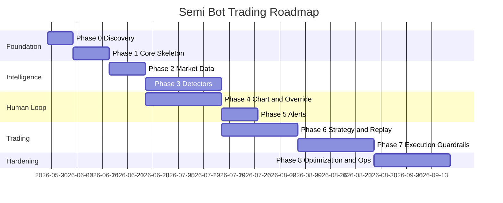

# 08 - Development Phases

## Tổng quan phase

Thời gian chỉ là ước lượng để chia việc. Có thể chạy song song Chart UI và Detectors sau khi data model ổn. MVP hiện tại ưu tiên XAUUSD H1/M15, mock/historical file data trên Macbook, web app dark mode và replay/backtest trước live MT5.

## Phase 0 - Discovery và Specification

Mục tiêu:

- Chốt thị trường, broker, data provider, symbol, timeframe.
- Chốt định nghĩa detector cơ bản.
- Chốt mode execution ban đầu.
- Chốt risk policy đầu tiên.

Deliverables:

- Answered open questions v1.
- Product scope MVP: XAUUSD H1/M15, web dark mode, replay/backtest.
- Data provider decision: MVP dùng historical/mock file; live phase dùng MT5/Exness qua Python `MetaTrader5`.
- Broker/exchange decision: Exness MT5 sau MVP.
- Strategy playbook v1.
- UI wireframe thô.

Exit criteria:

- Có thể mô tả chính xác MVP dùng để làm gì và chưa làm gì.
- Có danh sách symbol/timeframe đầu tiên.
- Có rule bias/regime/zone v1 đủ để code.

## Phase 1 - Core Skeleton

Mục tiêu:

- Dựng project structure.
- Dựng API service, analyzer worker, UI skeleton.
- Dựng database schema base.
- Dựng config/env/logging/test foundation.

Deliverables:

- Python package cho analyzer/core domain.
- API backend.
- Web UI skeleton.
- Database migration.
- Schema cho candles, zones, overrides, trade ideas, orders, fills.
- Docker Compose local nếu cần.
- CI/test command.

Technical tasks:

- Define domain models.
- Define event/entity schemas.
- Define zone visual validity fields: `start_time`, `end_time`, `valid_from`, `valid_until`.
- Add repository layer.
- Add fixture loader.
- Add mock data stream.
- Add XAUUSD H1/M15 file loader.
- Add health endpoints.

Exit criteria:

- Chạy local được toàn bộ skeleton.
- UI hiển thị mock/replay candle chart XAUUSD.
- API trả mock effective context.
- Test suite chạy được.

## Phase 2 - Market Data Foundation

Mục tiêu:

- MVP: load historical/mock XAUUSD H1/M15 từ file.
- Lưu candle chuẩn.
- Stream/replay candle tới UI/analyzer.
- Sau MVP: thêm MT5 realtime adapter.

Deliverables:

- File data adapter.
- MT5 data adapter skeleton sau.
- Candle ingestion.
- Candle gap detection.
- Timeframe aggregation nếu cần.
- Replay stream.

Technical tasks:

- Implement OHLCV model.
- Implement symbol/timeframe config.
- Historical backfill.
- Replay update handler.
- Data freshness monitor.

Exit criteria:

- Chart replay chạy với XAUUSD H1/M15.
- Database có candle historical đủ để test detector.
- Hệ thống phát hiện data stale.

## Phase 3 - Market Intelligence Detectors V1

Mục tiêu:

- Bot detect được các entity quan trọng ở mức MVP.

Deliverables:

- Swing detector.
- HH/HL/LH/LL classification.
- BOS/CHOCH detector.
- Bias detector.
- Regime detector primary + overlays.
- Support/resistance detector.
- OB detector.
- FVG detector.
- Liquidity sweep detector.
- Consolidation detector.
- M15 price action confirmation detector: engulfing, pinbar, morning star, marubozu.
- Zone scoring v1.

Technical tasks:

- Unit tests bằng candle fixtures.
- Snapshot outputs.
- Store detected entities.
- Persist zone `start_time/end_time` and invalidation reason.
- Emit events when new entities appear.
- Mark provisional vs confirmed.

Exit criteria:

- Analyzer chạy trên historical data và tạo entity có cấu trúc.
- Detector không crash khi data thiếu.
- Có ít nhất 20-50 chart samples để review thủ công.
- Bias dùng H1 Market Structure; M15 ngược hướng chỉ là pullback nếu H1 chưa CHOCH.
- OB/FVG mitigation/invalidation theo rule đã chốt.

## Phase 4 - Chart UI và Human Override

Mục tiêu:

- Human nhìn được chart realtime và chỉnh được bot output.

Deliverables:

- Chart overlay cho zone/structure.
- Chart overlay cho historical/backtest/live trades.
- Entity inspector.
- Drag resize zone.
- Bias/regime override panel.
- Secondary bias panel do human set.
- Expiry selector.
- Override persistence.
- Effective context API.
- Audit history view basic.
- Replay controls.

Technical tasks:

- Overlay rendering.
- Selection model.
- Save override endpoint.
- Apply override service.
- Expiry worker/job.
- UI state sync after save.

Exit criteria:

- Human chỉnh được resistance/support/OB/FVG trên chart.
- UI hiển thị active zone kéo tới candle hiện tại và invalidated zone dừng tại `end_time`.
- UI vẽ được toàn bộ trade history từ database.
- Human override bias thành bearish 4h và system dùng value đó.
- Hết expiry, hệ thống alert và recompute H1 bias trước khi effective context quay về bot value.
- Human set được secondary bias cho playbook breakout/mean reversion.
- Audit trail xem được.

## Phase 5 - Telegram Alerts

Mục tiêu:

- Alert realtime các event đáng chú ý.

Deliverables:

- Telegram bot integration.
- Alert event model.
- Dedupe/suppression rules.
- Alert templates.
- System alerts.
- Optional chart snapshot cho setup entry/SL/TP.

Technical tasks:

- Telegram sender worker.
- Event filter by severity/weight.
- Entity link to chart.
- Retry failed sends.
- Mute config basic.

Exit criteria:

- Entity mới gửi private Telegram.
- Price approaching/touched zone gửi đúng, không spam.
- Liquidity sweep gửi message có context.
- Bias/regime/state change gửi Telegram.
- Data stale gửi critical alert.

## Phase 6 - Strategy Engine và Replay/Backtest

Mục tiêu:

- Tạo setup candidate theo playbook và test bằng replay/backtest.

Deliverables:

- Strategy Engine v1.
- Playbook config.
- Trade idea model.
- Trade order/fill model.
- Replay/backtest engine.
- Backtest PnL report basic.

Technical tasks:

- Implement trend pullback playbook.
- Implement sweep reversal playbook.
- Implement breakout/retest playbook.
- Implement range mean reversion playbook sau.
- Snapshot context when creating trade idea.
- Track trade lifecycle in replay/backtest mode.
- Apply risk defaults: 1% risk, max daily loss 5%, max 10 trades/day, min RR 1:2.

Exit criteria:

- Bot tạo setup candidate có lý do rõ.
- Backtest trade được mở/đóng theo rule.
- Có report theo playbook.
- Human override ảnh hưởng strategy đúng như expected.

## Phase 7 - Guarded Execution

Mục tiêu:

- Chuẩn bị live execution có kiểm soát, chưa full auto.

Deliverables:

- MT5/Exness broker adapter đầu tiên.
- Risk Engine.
- Execution request lifecycle.
- Human confirmation workflow.
- Kill switch.
- Position/order sync.

Technical tasks:

- Implement MT5 broker client bằng Python `MetaTrader5`.
- Implement risk checks.
- Implement approve/reject flow.
- Implement execution logs.
- Implement emergency disable.

Exit criteria:

- Execution mặc định bị chặn nếu chưa confirm.
- Risk rejection có lý do rõ.
- Hỗ trợ market và limit order.
- Human confirm trên UI; timeout 5 phút áp dụng rule limit/market đã chốt.
- Kill switch chặn toàn bộ request mới.

## Phase 8 - Backtest, Optimization và Operations

Mục tiêu:

- Biến hệ thống thành công cụ có thể tin cậy lâu dài.

Deliverables:

- Replay/backtest engine.
- Detector quality dashboard.
- Trade analytics.
- Operations dashboard.
- Backup/restore.
- Deployment guide.

Technical tasks:

- Historical replay through same analyzer.
- Compare bot raw vs human-adjusted zones.
- Export CSV/HTML reports.
- Add monitoring metrics.
- Add alert configuration UI.

Exit criteria:

- Backtest/replay tái hiện entity theo thời gian.
- Đo được playbook performance.
- Đo được impact của human override.
- Có checklist deploy/live readiness.

## MVP đề xuất

MVP nên gồm Phase 1-6:

- Data historical/mock XAUUSD H1/M15.
- Detector v1.
- Chart UI.
- Human override.
- Telegram alert.
- Replay/backtest.
- Không live execution.

Sau khi replay/backtest ổn và thu đủ log, mới chuyển sang Phase 7 guarded MT5 execution.

## Milestone theo giá trị

Milestone A: "Nhìn được chart có bot annotation"

- Chart realtime.
- Detector cơ bản.
- Overlay.

Milestone B: "Human sửa được bot"

- Override zone.
- Override bias/regime.
- Expiry.
- Audit.

Milestone C: "Không cần nhìn chart liên tục"

- Telegram alert.
- Dedupe.
- Link về chart.

Milestone D: "Biết setup nào đáng trade"

- Strategy Engine.
- Replay/backtest trade.
- Report.

Milestone E: "Có thể execution có kiểm soát"

- Risk Engine.
- Broker adapter.
- Human confirmation.
- Kill switch.
